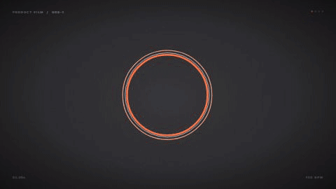
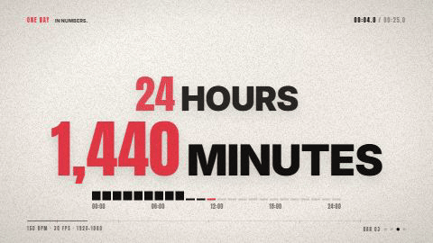
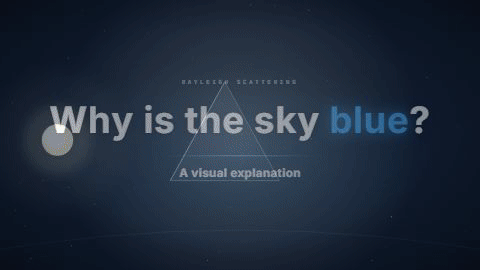
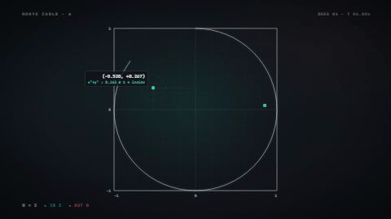
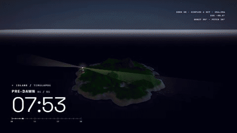

# One prompt, one 25-second video

Five free prompts that make an AI coding agent build a finished 25-second video: visuals in [Remotion](https://www.remotion.dev/) (and Three.js for 3D), music synthesized in Node.js. No stock footage, no audio files, nothing to import.

| # | Prompt | What it makes |
|---|---|---|
| 01 | [`prompts/01_launch.txt`](prompts/01_launch.txt) | Launch film for a fictional spherical speaker |
| 02 | [`prompts/02_kinetic_day.txt`](prompts/02_kinetic_day.txt) | Kinetic typography: how many seconds are in a day |
| 03 | [`prompts/03_blue_sky.txt`](prompts/03_blue_sky.txt) | Science explainer: why the sky is blue |
| 04 | [`prompts/04_montecarlo_pi.txt`](prompts/04_montecarlo_pi.txt) | Math explainer: estimating pi with random points |
| 05 | [`prompts/05_island_3d.txt`](prompts/05_island_3d.txt) | Procedural 3D island, one day as a time-lapse |

## How to use

1. Make an empty folder and start a coding agent that can edit files and run commands (for example Claude Code) in it. You also need Node.js.
2. Paste one whole prompt file and send it.
3. Play the MP4. Ask for changes by the second: "At 10s the label overlaps the title. Move it down."

## How the prompts are written

Each prompt is a short spec sheet: `[Overview]`, `[Timeline]`, `[Design]`, `[Motion]`, `[Sound]`, `[Output]`. Every tempo puts one beat on a whole number of frames at 30fps (120 BPM = 15 frames), so picture and music stay in step. Change the words in quotes, the colors, or the names to make it yours.

## Good to know

- Results vary with the agent, model, and environment. Your render will be similar to the preview, not identical.
- The previews come from our own production run, where the agent also reviewed stills and refined its work. A single paste can give a simpler result.
- Every video here is rendered from code that an AI coding agent wrote from the prompt shown. The prompts were designed and tested by a creator in Japan; the English text is AI-translated and checked by re-running each prompt.
- All brand and people names are fictional placeholders.
- Remotion is free for individuals and companies of up to 3 people; larger companies need a Remotion company license.

## More

30 more tested prompts (3D scenes, launch films, logo reveals, UI demos, creator assets), with previews: https://sekkeimotion.gumroad.com/l/starter

## License

You may use these prompts and the videos you render with them in personal and commercial projects. Please do not resell the prompt files.
